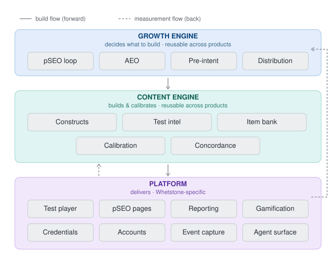

# Architecture at a glance

A top-down block diagram of the platform, from users down to the business model and the
two-year destination. **Green** = designed/decided (architecture settled, even if no
code exists yet). **Amber** = a big open problem still to build. **Purple** = the
two-year north-star destination everything else builds toward.

## Reading it
- **Users → Acquisition → Delivery** is the outward-facing path: how candidates (and
  increasingly, AI answer engines) find and reach the product. → `04-growth-engine.md`
- **Core engine → Test Intelligence → AI authoring → Content pipeline** is how content
  gets made and kept accurate — Test Intelligence now covers vendor mapping and
  geography, not just format. → `02-product-architecture.md`
- **Data & trust** is the spine that makes the moat and eventual credential possible. →
  `03-data-and-trust.md`
- **Reporting & engagement** — new tier: what turns the data spine into something a
  user actually experiences (insight, gamification, a signed credential). Previously
  entirely missing from this diagram. → `02-product-architecture.md`, `03-data-and-trust.md`
- **Business model & destination** is where it's all going. → `01-strategy.md`

**Deliberately left off this diagram** (kept sparse by design — detail lives in the
topic docs, not here): the community/live-events channel, LinkedIn specifics, and daily
micro-content — all real, all documented in `04-growth-engine.md`, just not diagram-level
concepts.

## What's genuinely unresolved (amber)
Four clusters, not scattered problems:
1. **Test Intelligence** — sourcing and maintaining accurate test-format, vendor, and
   geography data per employer/publisher.
2. **Item bank evolution + Concordance model** — the data-and-signal problems: turning
   volume into a self-improving bank and a trustworthy predictive score.
3. **Reporting, gamification, credential signing** — the entire user-facing layer that
   turns the data spine into an experience. Credential signing is the one Ankur elevated
   to top priority within this cluster.
4. **Agent tool surface (MCP) + Monetization** — both deliberately deferred, not hard,
   just not-now.

Everything else on the diagram is architecturally settled — the work left is building
what's already been decided, not deciding what to build.

*Full detail behind every box lives in the topic docs linked above; the reasoning trail
behind each decision lives in `../memory/decisions.md`.*

*Diagram source: `architecture-diagram.svg` (hand-maintained — update it directly when a
box's status changes, e.g. amber → green once something ships or a design resolves).*

---

## A second cut: ownership and data flow

The diagram above is organized by **business capability** (what layer does this
belong to). This one is organized by **app ownership** (`05-tech-stack.md`, D23) —
which of the three services (Growth Engine, Content Engine, Platform) owns each module,
and how data actually moves between them.

**The forward flow (solid arrows) — decide → build → deliver:** Growth Engine scores an
opportunity and sends Content Engine a build signal (this company × publisher ×
geography cluster is worth a skin). Content Engine's Test Intelligence sources the real
detail, the construct engine generates + calibrates the items, and it's exposed as a
skin via API. Platform renders both the test-taking experience *and* the pSEO page —
combining Content Engine's real test data with Growth Engine's separate SEO/AEO
requirements (schema.org, meta patterns, target keyword cluster).

**The backward flow (dashed arrows) — measurement forks in two, not one loop:** Platform
captures a single raw event stream. It splits to two different consumers for two
different purposes: item-response data flows to **Content Engine** for IRT calibration
and item-bank evolution; page-level traffic/engagement data flows to **Growth Engine**
(alongside GSC data it pulls independently) to close its own opportunity-scoring loop.
Same source, two destinations, two different jobs — this is D25's key clarification.

*Diagram source: `ownership-dataflow-diagram.svg` — update when a module changes owner
or a new data-flow path is added.*
