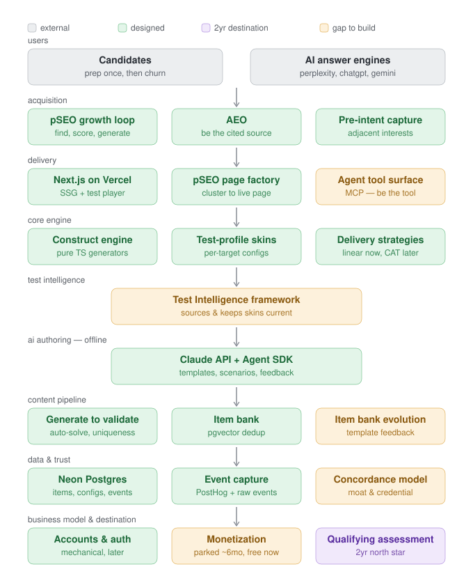

# Architecture at a glance

A top-down block diagram of the platform, from users down to the business model and the
two-year destination. **Green** = designed/decided (architecture settled, even if no
code exists yet). **Amber** = a big open problem still to build. **Purple** = the
two-year north-star destination everything else builds toward.

## Reading it
- **Users → Acquisition → Delivery** is the outward-facing path: how candidates (and
  increasingly, AI answer engines) find and reach the product. → `04-growth-engine.md`
- **Core engine → Test Intelligence → AI authoring → Content pipeline** is how content
  gets made and kept accurate. → `02-product-architecture.md`
- **Data & trust** is the spine that makes the moat and eventual credential possible. →
  `03-data-and-trust.md`
- **Business model & destination** is where it's all going. → `01-strategy.md`

## What's genuinely unresolved (amber)
Three clusters, not scattered problems:
1. **Test Intelligence** — sourcing and maintaining accurate test-format data per
   employer/publisher.
2. **Item bank evolution + Concordance model** — the data-and-signal problems: turning
   volume into a self-improving bank and a trustworthy predictive score.
3. **Agent tool surface (MCP) + Monetization** — both deliberately deferred, not hard,
   just not-now.

Everything else on the diagram is architecturally settled — the work left is building
what's already been decided, not deciding what to build.

*Full detail behind every box lives in the topic docs linked above; the reasoning trail
behind each decision lives in `../memory/decisions.md`.*

*Diagram source: `architecture-diagram.svg` (hand-maintained — update it directly when a
box's status changes, e.g. amber → green once something ships or a design resolves).*
