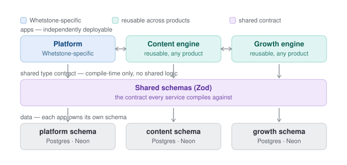

# Tech stack & tooling

*Full reasoning + rejected alternatives: `memory/decisions.md` D7, D8, D23.*

## Service boundaries: Platform / Content Engine / Growth Engine
Three independently deployable apps, all in the **same Turborepo monorepo** — not
separate repos. Independence comes from clean contracts, not physical repo separation.

- **Platform** — the customer-facing Next.js app (delivery, reporting, gamification,
  pSEO pages). Whetstone-specific.
- **Content Engine** — the construct engine, item lifecycle, calibration
  (`02-product-architecture.md`, `03-data-and-trust.md`). **Reusable across products.**
- **Growth Engine** — the SEO/AEO tooling (`04-growth-engine.md`). **Reusable across
  products** — designed so a future venture can use it without touching Whetstone.

**What makes "independent yet seamlessly leveraged" real, not aspirational:**
- **The only shared code is a type contract, never business logic** — a `schemas/`
  package (Zod) with item/skin/growth-opportunity/credential definitions. Every app
  compiles against it; none import each other's internals.
- **Runtime communication is typed HTTP, not shared DB access.** Platform calls Content
  Engine's API for items; it never reads its tables directly.
- **Each app owns its own Postgres schema** — same Neon instance for now, logically
  separated so a future physical split is a config change, not a migration project.
- **No product-specific hardcoding inside Content Engine or Growth Engine** — keyword
  seeds, branding, domain names get supplied to them as config from outside. Whetstone
  is their first customer, not baked into their core. This is the D22 vertical-agnostic
  principle applied to a second, independent axis: cross-*product* portability, not just
  cross-*test-type* portability.

**A real decision, not a default:** lean toward **plain Zod-validated HTTP APIs over
tRPC** for the Content-Engine/Growth-Engine boundary specifically — tRPC ties consumers
to sharing this exact type-import setup, which works against reuse the moment a consumer
isn't in this repo.

**Open:** the worker/job runtime for Content Engine + Growth Engine (Vercel Cron vs. a
dedicated worker) isn't decided — they're batch/AI-call-shaped, a different profile than
Platform's low-latency serving. → `open-questions.md` §R.

**Guardrail:** all of this fits in the same repo on day one. Physical extraction to a
separate repo/deploy target is a lever to pull when a second product genuinely needs it,
not before.

## Stack
One TypeScript codebase, chosen for maximum coding-agent velocity (dense training
corpus, one language boundary, types catch AI-output bugs at the edge).

| Layer | Choice | Why |
|---|---|---|
| Language | **TypeScript** everywhere | One documented exception: offline psychometric calibration (IRT) may use Python if the stats ecosystem earns it — never user-facing. |
| Web | **Next.js (App Router)** | SSG/ISR statically renders thousands of long-tail pages (`04-growth-engine.md`) while React runs the interactive test player. |
| Hosting | **Vercel** | Best Next.js DX, zero-config ISR + preview deploys, fastest agent iteration. Chosen over Cloudflare for velocity-to-first-1000-pages. |
| Data | **Neon** (serverless Postgres) + **Drizzle** ORM + **pgvector** | Postgres over SQLite/D1 because concordance (`03-data-and-trust.md`) is a data play; pgvector handles item dedup/answer-uniqueness in the same DB; Neon DB-branching pairs with per-PR throwaway databases. |
| Schemas | **Zod** | The backbone, not a detail — skins, item schemas, and every AI output are Zod schemas. A new "test" = a validated config object. |
| AI | **Claude API + Agent SDK** | The offline generate→validate loop (`02-product-architecture.md`), outputs forced through Zod. |
| Analytics | **PostHog** + raw events → Postgres | Concordance signal from day one (`03-data-and-trust.md`). |
| Auth | Deferred; **Clerk** when needed | v1 is no-signup; drop in when accounts + readiness scores arrive. |
| Tooling | pnpm + Turborepo, Vitest + Playwright, Biome, Sentry | Standard fast/full gate discipline. |

**Rejected:** Cloudflare Workers/Pages+D1/R2 (rougher Next.js story via OpenNext, D1 is
SQLite not Postgres — revisit only if unit-cost at scale ever beats time-to-validation);
a Python/JS split for the app (context-switch tax on every agent session); Prisma
(Drizzle's transparent SQL is easier for agents to reason about than codegen).

## Key principle: no AI in the hot path
Because answers are machine-verifiable, the construct engine is **deterministic
TypeScript generators** — pure functions that emit an item *and its proven-correct
answer* from parameters (infinite calibrated instances, ~$0, zero hallucination). AI's
role is narrower and offline:
1. author the generator templates once (reviewed),
2. write verbal/SJT scenario content where determinism doesn't apply,
3. write feedback prose at runtime.

This is "the validation loop is the asset" expressed in code — it makes the engine cheap
and testable. See `02-product-architecture.md` for how this feeds item-bank evolution.

## The agent-callable seam (MCP) — reserve now, build later
Discovery is moving from Google search to AI agents. The deepest form of "optimise for
agents" is being the **tool the agent invokes** ("give me a numerical reasoning practice
test") — not just a cited page. So the construct engine sits behind a clean, API-first
boundary from day one, with an **MCP server** surface planned over it. Natural
early-mover edge pure-content competitors can't follow — but **don't build it in v1**;
just keep the boundary clean so it drops in later. See `04-growth-engine.md` for the AEO
context this serves.

## Tooling & working style
All research + report generation runs as **code in Claude Code** — reproducible,
autonomous, lives with the repo (the kit in `tools/aptitude-market-research/`). The web
Chat tab is for strategy discussions; the browser/Chrome extension is reserve-only for
no-API sources and one-off human-in-the-loop lookups. Even browser *collection*, if ever
needed, is more robust as Playwright code than a live extension. **Official APIs only** —
never scrape Ahrefs/Semrush/LinkedIn/Similarweb UIs (ToS violation, account-ban risk).
